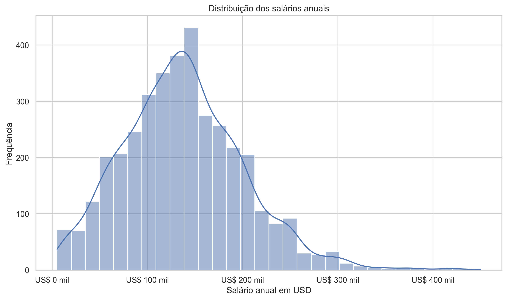
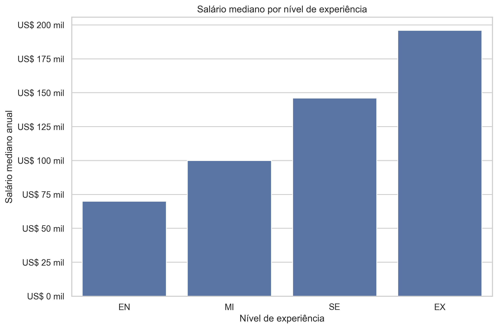
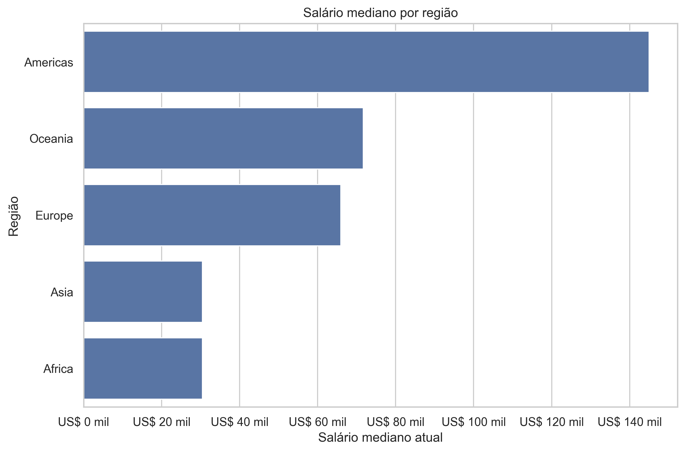
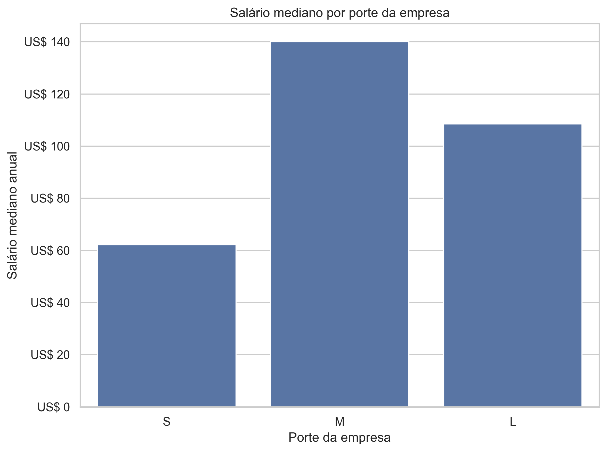
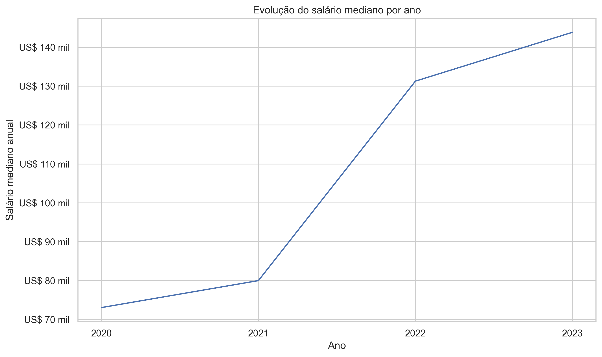
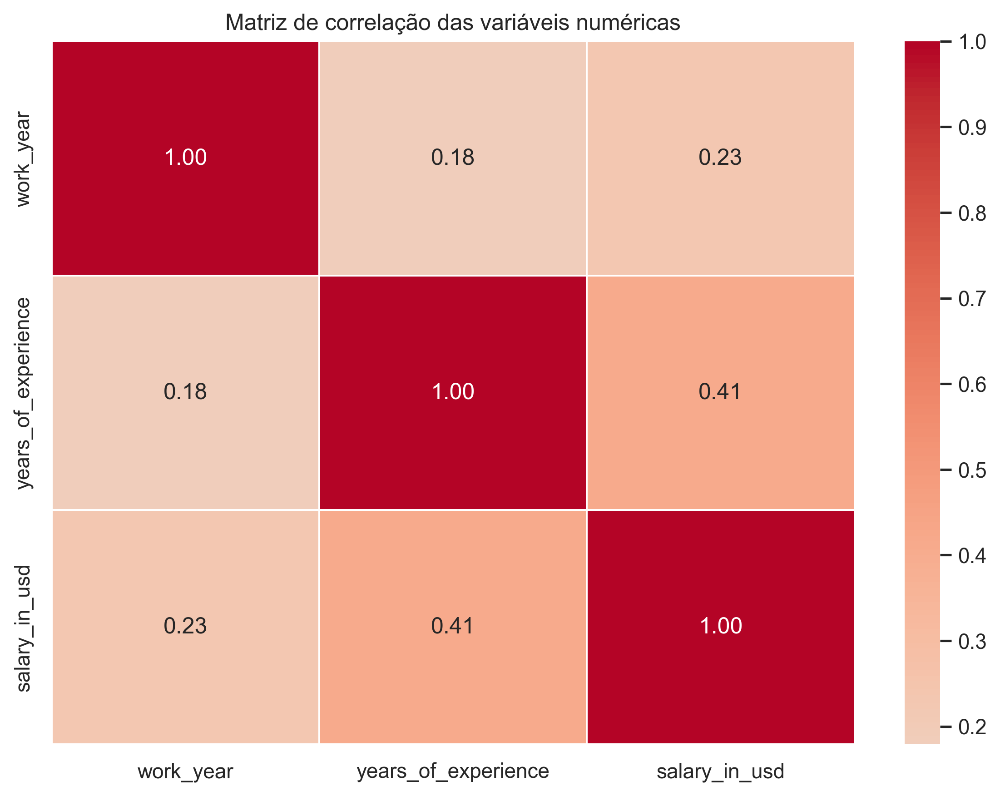

# Data Professionals Salary Analysis

Projeto de **Análise de Dados e Estatística Descritiva** desenvolvido com Python para investigar os principais fatores associados aos salários de profissionais da área de dados.

A análise explora diferenças salariais relacionadas a experiência, cargo, localização, porte da empresa e período do registro, utilizando técnicas de análise exploratória, estatística descritiva e visualização de dados.

---

## 📌 Visão geral

A base analisada possui **3.755 registros** e **10 variáveis**, incluindo informações sobre:

- ano do registro;
- país;
- região;
- nível de experiência;
- cargo;
- salário anual em dólares;
- residência do profissional;
- localização da empresa;
- porte da empresa;
- anos de experiência.

A variável principal da análise é `salary_in_usd`.

---

## 🎯 Objetivo

O objetivo deste projeto é compreender como diferentes características profissionais, geográficas e organizacionais estão associadas aos salários de profissionais de dados.

Entre as principais perguntas investigadas estão:

- como os salários variam conforme a experiência;
- quais cargos apresentam maiores remunerações;
- como a localização geográfica está associada aos salários;
- empresas maiores necessariamente pagam mais;
- como os salários evoluíram entre 2020 e 2023;
- qual é o nível de dispersão salarial da base;
- os valores extremos representam erros ou casos plausíveis;
- quais variáveis numéricas apresentam maior correlação com o salário.

---

## 🧹 Qualidade dos dados

A inspeção inicial identificou:

- **3.755 registros**;
- **10 colunas**;
- **0 valores ausentes**;
- **786 registros completamente iguais**.

As linhas repetidas não foram removidas automaticamente.

A base não possui identificador único por profissional, portanto não é possível afirmar se duas linhas iguais representam registros duplicados ou profissionais diferentes com as mesmas características.

Para evitar a exclusão indevida de observações potencialmente legítimas, esses registros foram mantidos.

---

## 📊 Estatística descritiva dos salários

A variável `salary_in_usd` apresentou:

| Indicador     |              Valor |
| ------------- | -----------------: |
| Média         | **US$ 137.570,39** |
| Mediana       | **US$ 135.000,00** |
| Desvio padrão |  **US$ 63.055,63** |
| Mínimo        |   **US$ 5.132,00** |
| Q1            |  **US$ 95.000,00** |
| Q3            | **US$ 175.000,00** |
| Máximo        | **US$ 450.000,00** |

O coeficiente de variação foi de aproximadamente **45,84%**, indicando elevada dispersão salarial.

A assimetria foi de aproximadamente **0,5364**, indicando uma distribuição moderadamente assimétrica à direita.

### Distribuição dos salários



---

## 📈 Salário por nível de experiência

A mediana salarial aumenta de forma consistente conforme cresce a senioridade:

| Nível       |         Mediana |
| ----------- | --------------: |
| Entry-level |  **US$ 70.000** |
| Mid-level   | **US$ 100.000** |
| Senior      | **US$ 146.000** |
| Executive   | **US$ 196.000** |

A evolução percentual da mediana foi:

- Entry → Mid: **+42,86%**
- Mid → Senior: **+46,00%**
- Senior → Executive: **+34,25%**

### Visualização



---

## 💼 Salário por cargo

A base possui **93 cargos diferentes**.

Para evitar rankings influenciados por funções com poucas observações, a comparação salarial foi restringida a cargos com pelo menos **30 registros**.

Entre os cargos analisados, algumas das maiores medianas foram:

- `Applied Scientist`: aproximadamente **US$ 191,7 mil**
- `Data Science Manager`: aproximadamente **US$ 183,8 mil**
- `Data Architect`: aproximadamente **US$ 160 mil**
- `ML Engineer`: aproximadamente **US$ 160 mil**
- `Research Engineer`: aproximadamente **US$ 155 mil**

Os cargos mais frequentes da base são:

- `Data Engineer`
- `Data Scientist`
- `Data Analyst`

---

## 🌍 Salário por localização

A localização apresentou forte associação com a remuneração.

Entre os países com pelo menos 30 observações, as maiores medianas foram:

| País           |         Mediana |
| -------------- | --------------: |
| Estados Unidos | **US$ 145.000** |
| Canadá         | **US$ 120.000** |
| Reino Unido    |  **US$ 80.036** |
| Alemanha       |  **US$ 76.833** |

A Índia apresentou mediana de aproximadamente **US$ 20.670**.

Essas diferenças devem ser interpretadas com cautela, pois a base é fortemente concentrada nos Estados Unidos e nas Américas.

### Visualização



---

## 🏢 Salário por porte da empresa

A mediana salarial observada foi:

| Porte   |           Mediana |
| ------- | ----------------: |
| Pequena |  **US$ 62,1 mil** |
| Média   |   **US$ 140 mil** |
| Grande  | **US$ 108,5 mil** |

O resultado mostra que a relação entre porte da empresa e salário não é linear.

Empresas médias apresentaram maior mediana salarial do que empresas grandes e pequenas.

### Visualização



---

## 🧠 Anos de experiência e salário

A correlação entre `years_of_experience` e `salary_in_usd` foi de aproximadamente:

**0,4107**

Esse valor indica uma associação linear positiva moderada.

A análise das medianas também mostrou crescimento relevante da remuneração conforme aumentam os anos de experiência.

Entretanto, profissionais com a mesma quantidade de experiência podem apresentar salários bastante diferentes, indicando que outros fatores também influenciam a remuneração.

---

## 📅 Evolução salarial ao longo do tempo

A mediana salarial evoluiu da seguinte forma:

| Ano  |         Mediana |
| ---- | --------------: |
| 2020 |  **US$ 73.065** |
| 2021 |  **US$ 80.000** |
| 2022 | **US$ 131.300** |
| 2023 | **US$ 143.860** |

A maior variação ocorreu entre 2021 e 2022.

É importante destacar que a quantidade de observações cresce significativamente nos anos mais recentes, portanto a composição da amostra também influencia essa evolução.

### Visualização



---

## 🔬 Outliers salariais

Pelo método do intervalo interquartil, foram identificados **63 possíveis outliers**, equivalentes a aproximadamente **1,68% da base**.

O limite superior foi de aproximadamente:

**US$ 295.000**

A análise mostrou que a maior parte desses registros pertence a:

- profissionais Senior;
- profissionais Executive;
- cargos especializados;
- profissionais dos Estados Unidos.

Como os valores apresentaram características plausíveis, eles foram mantidos na análise.

---

## 🔗 Correlações

Entre as variáveis numéricas:

- `years_of_experience` × `salary_in_usd`: **0,4107**
- `work_year` × `salary_in_usd`: **0,2283**
- `work_year` × `years_of_experience`: **0,1789**

Os resultados reforçam que nenhuma variável numérica isolada explica completamente as diferenças salariais.

### Matriz de correlação



---

## 💡 Principais insights

Os principais resultados encontrados foram:

- maior experiência está associada a salários mais elevados;
- cargos especializados e de gestão apresentam remunerações superiores;
- localização geográfica está fortemente associada ao salário;
- empresas médias apresentaram maior mediana salarial;
- os salários registrados em 2022 e 2023 são superiores aos anos anteriores;
- a distribuição salarial possui elevada dispersão;
- os outliers representam pequena parcela da base e parecem plausíveis;
- o salário possui natureza multifatorial.

---

## ⚠️ Limitações

Algumas limitações devem ser consideradas:

- forte concentração de registros nos Estados Unidos;
- predominância de profissionais Senior;
- predominância de empresas médias;
- maior quantidade de registros em 2022 e 2023;
- algumas regiões e países possuem poucas observações;
- ausência de identificador único por profissional;
- análises predominantemente descritivas e associativas;
- correlação não implica causalidade;
- fatores como formação, benefícios, setor da empresa e custo de vida não estão disponíveis.

---

## 🚀 Possíveis próximos passos

O projeto pode evoluir com:

- testes estatísticos entre grupos;
- análise de significância;
- regressão múltipla;
- modelos de previsão salarial;
- análise por país;
- estudo de interação entre cargo e experiência;
- normalização por custo de vida;
- dashboards interativos;
- comparação com novas bases salariais.

---

## 🛠️ Tecnologias utilizadas

- Python
- Pandas
- NumPy
- Matplotlib
- Seaborn
- Jupyter Notebook
- Git
- GitHub

---

## 📁 Estrutura do projeto

```text
data-salary-statistical-analysis/
│
├── data/
│   └── salario_profissionais_dados.csv
│
├── images/
│   ├── distribuicao_salarios.png
│   ├── salario_mediano_experiencia.png
│   ├── salario_mediano_pais.png
│   ├── salario_mediano_empresa.png
│   ├── evolucao_salario_mediano.png
│   └── matriz_correlacao.png
│
├── notebooks/
│   └── salary_statistical_analysis.ipynb
│
├── src/
│   └── data_processing.py
│
├── .gitignore
├── README.md
└── requirements.txt
```

---

## ⚙️ Como executar

### 1. Clone o repositório

```bash
git clone URL_DO_REPOSITORIO
```

Entre na pasta:

```bash
cd data-salary-statistical-analysis
```

### 2. Crie um ambiente virtual

```bash
python -m venv .venv
```

No Windows:

```bash
.venv\Scripts\activate
```

### 3. Instale as dependências

```bash
pip install -r requirements.txt
```

### 4. Valide o carregamento dos dados

```bash
python src/data_processing.py
```

### 5. Abra o notebook

```text
notebooks/salary_statistical_analysis.ipynb
```

O notebook contém todas as etapas da análise, desde a inspeção inicial até os principais insights e conclusões.

---

## ✅ Conclusão

Este projeto demonstrou como técnicas de estatística descritiva e análise exploratória podem ser utilizadas para compreender padrões salariais no mercado de profissionais de dados.

Os resultados evidenciaram diferenças importantes relacionadas à experiência, cargo, localização, porte da empresa e período analisado.

A análise também mostrou que a remuneração possui natureza multifatorial e deve ser interpretada considerando simultaneamente diferentes características profissionais e geográficas.

Além dos resultados quantitativos, o projeto reforça a importância de avaliar qualidade dos dados, tamanho das amostras, outliers e limitações antes de formular conclusões.

---

## 👨‍💻 Autor

**João Vitor Duarte de Oliveira**  
Análise de Dados | Ciência de Dados | Python | SQL

Projeto desenvolvido como parte do meu portfólio profissional, com foco em análise exploratória, estatística descritiva, visualização de dados e interpretação de resultados.

- **GitHub:** [Jv-ghost](https://github.com/Jv-ghost)
- **LinkedIn:** [João Vitor Duarte de Oliveira](htpps://www.linkedin.com/in/joão-vitor-duarte-de-olliveira)

---

⭐ Se este projeto foi útil ou interessante, fique à vontade para explorar o repositório.
